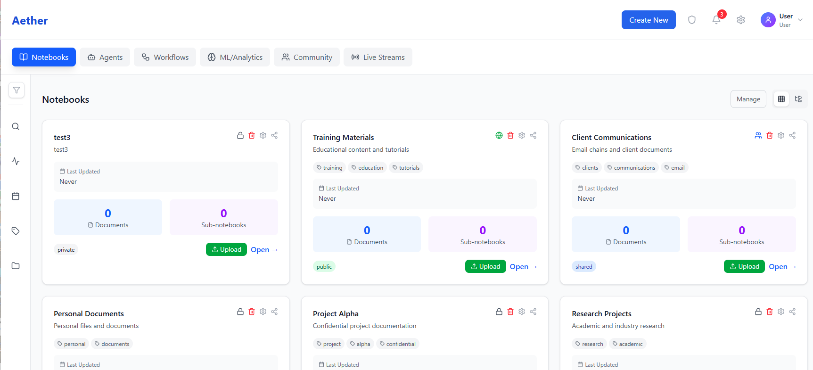
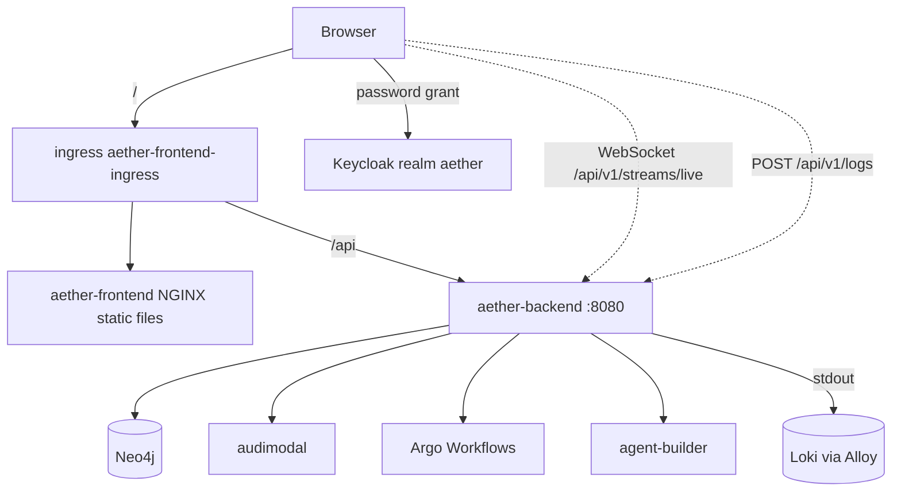

# Aether — the TAS platform front end



## 🧭 What this is

Aether is the browser application people sign into to use the Tributary AI Services (TAS) platform: notebooks of multimodal documents, agents configured through a form, workflows drawn on a canvas, spaces shared with a team, and a live event feed. It is a React 19 single-page application (SPA), built by Vite and served as static files by NGINX.

It is not the platform. No server, no database, no model inference lives here. Document processing belongs to `audimodal`, model routing to `tas-llm-router`, and graph plus relational storage sits behind `aether-be`. Every screen that shows real data is a view over the `aether-be` API, and some screens and dialogs still show fixtures built into the bundle. Start this repository on its own and you get a login form and, after signing in, empty screens — which is the single most common first-run surprise and is covered under Quick start below.

## 📌 Status & scope

**Verified 2026-11-22.** This runs in production as version 1.2.0. The deployment is `aether-frontend` in namespace `aether-be` on the TAS K3s cluster, reachable at `https://aether.tas.scharber.com` through the ingress `aether-frontend-ingress`. That ingress routes `/` to this application and `/api` on the same host to `aether-backend:8080`. The image is pinned by tag and digest:

```text
registry-api.tas.scharber.com/aether-frontend:1.2.0@sha256:78df978f943c56afc8292d78228e20b44600ac4f462ac6a7713e2569acfcdbe2
```

What is merged is also what is live, as far as the bundle can show. The served stylesheet and `agentBuilder` chunk are byte-identical to a build of `d898578` with the production arguments. The main script is not byte-identical (10 bytes shorter), but a token comparison found no differing string or name longer than four characters, one `const` keyword aside, and it contains the code of the two newest features: agent visibility (Only me, My organization, Public) and the team tree with join requests and "member since". The pods started on 2026-11-21 at 19:12 UTC, 28 minutes after that commit.

There are two replicas with a soft rule to spread them across the two nodes. On 2026-11-22 both were on `pinova01`, so losing that node takes the front end down until a pod is rescheduled.

**How a change gets there.** Nothing ships on merge, because this repository has no continuous integration (CI). Someone has to:

1. Bump `version` in `package.json` and merge.
2. Build the image with the production build arguments, tag it with that version, and push it. A local image is never picked up. `docker push` prints the digest that step 3 needs.
3. Put the new tag and digest in the `image:` line of `k8s-aether-app/aether-frontend.yaml` in the `aether-shared` repository, which is where the running deployment is declared, and merge that. Then apply it by hand from an updated checkout. That file holds more than the Deployment, so read the diff before applying.

For version 1.2.0 the commands would be these (substitute the version you bumped to):

```bash
# step 2, from this repository
docker build -t registry-api.tas.scharber.com/aether-frontend:1.2.0 \
  --build-arg VITE_AETHER_API_BASE= \
  --build-arg VITE_AETHER_API_URL=/api/v1 \
  --build-arg VITE_KEYCLOAK_URL= \
  --build-arg VITE_KEYCLOAK_REALM=aether \
  --build-arg VITE_KEYCLOAK_CLIENT_ID=aether-frontend \
  -f Dockerfile .
docker push registry-api.tas.scharber.com/aether-frontend:1.2.0

# step 3, from aether-shared, after the manifest change is merged
kubectl diff -f k8s-aether-app/aether-frontend.yaml
kubectl apply -f k8s-aether-app/aether-frontend.yaml
kubectl rollout status deployment/aether-frontend -n aether-be

# confirm: the bundle name served should match the one your build printed
curl -s https://aether.tas.scharber.com/ | grep -o 'index-[^"]*\.js'

# roll back to the previous revision
kubectl rollout undo deployment/aether-frontend -n aether-be
```

> [!UNVERIFIED] These deploy and rollback commands were not run on 2026-11-22, because they change production. The build arguments come from [./CLAUDE.md](./CLAUDE.md) and the apply step from `k8s-aether-app/README.md` in `aether-shared`; who approves a production rollout is not recorded in either. After a rollback, revert the pin in the manifest too, or the next apply restores it.

Steps 2 to 4 of the procedure in `./CLAUDE.md` (tag and push `:latest`, delete the pods) no longer ship anything. A replacement pod pulls the pinned digest again, despite `imagePullPolicy: Always`.

The useful split is not by feature name but by what is wired to the backend. There are three groups: backend-backed, backend with a fixture fallback, and demo only.

| Area | State today | Evidence |
|---|---|---|
| Notebooks, documents, productions, spaces, comments, invitations, chat conversations | Backend-backed | `src/services/aetherApi.js:24` request path; slices in `src/store/slices/` |
| Teams and organizations | Backend-backed. Failed team actions now report an error; before 1.2.0 they invented a successful result | `src/store/slices/teamsSlice.js:5` |
| Notebook sharing | Team and email sharing are backend-backed. Searching for a user or an organization returns hard-coded names | `src/components/notebooks/ShareNotebookModal.jsx:200` |
| Workflows (canvas, templates, publish, execute) | Backend-backed, with Argo behind `aether-be` | `src/services/api.js:749` delegates to `aetherApi.workflows` |
| Compliance violations panel and badge | Backend-backed | `src/store/slices/complianceSlice.js:55`; `GET /api/v1/compliance/summary` answers 401 without a token |
| Notifications | Backend-backed, polled every 30 seconds | `src/store/slices/notificationsSlice.js:12` |
| Live Streams | Backend-backed over a WebSocket, with no demo fallback | `src/services/streamingSocket.js:6` connects `/api/v1/streams/live` |
| Agent Builder, onboarding | Backend-backed through direct `fetch` calls. The "configuration valid" check is a stub that always passes | `src/services/api.js:71`, stub at `src/services/api.js:607` |
| Developer Tools, query console, schema, Neo4j and Kafka explorers | Backend-backed, except the two rows below | slices in `src/store/slices/` |
| Model Context Protocol (MCP) Testing tab | Real, but shows invented "connected" servers when the API call fails | `src/components/developer-tools/MCPTestingTab.jsx:82` |
| AI Playground tab | Demo only: random delay, tokens, cost and a canned reply | `src/components/developer-tools/AIPlaygroundTab.jsx:153` |
| Skills in notebooks and in the agent form | Real, but shows fixtures when the list is empty or the call fails | `src/store/slices/skillsSlice.js:13`, `src/components/modals/AgentCreateModal.jsx:141` |
| Community marketplace | MCP servers are real. Skills fall back to fixtures on error, workflows whenever the public list is empty. The community catalogue is always fixtures, plus optional real system tools | `src/pages/CommunityPage.jsx:43`, `src/pages/CommunityPage.jsx:150`, `src/pages/CommunityPage.jsx:165` |
| ML/Analytics page, its three charts, and model or experiment lists | Static demo data, no network call at all | `src/pages/AnalyticsPage.jsx:2` imports from `src/data/mockData.js` |
| Notebook "view contents" and "export data" dialogs | Demo only: a fixed file tree, and an export that downloads nothing | `src/components/modals/ContentsViewModal.jsx:38`, `src/components/modals/ExportDataModal.jsx:82` |
| Renderer picker when running a producer | Always the hard-coded podcast entry, because the `api.get` it calls does not exist | `src/components/notebooks/RendererSelectModal.jsx:44` |
| Audit Trail modal | Static demo data | `src/context/AuditContext.jsx:16` |
| Forgot password | Demo only: says an email was sent and sends none | `src/pages/ForgotPasswordPage.jsx:43` |

> [!UNVERIFIED] No screen was exercised with a signed-in user on 2026-11-22. "Backend-backed" means the code calls the API. Unauthenticated probes of notebooks, teams, join requests, agents, skills, compliance summary and the stream endpoint returned 401, which shows those routes exist, not that they return correct data.

> [!UNVERIFIED] Agent visibility needs support in Agent Builder as well. Its deployed image `tas-agent-builder:1.0.0` was rolled out 13 minutes after that support was committed there, but the tag does not name a commit and the feature was not exercised.

Two claims that an older version of this page made are still untrue. There are **no tests**: no test files, no test runner in `package.json`, no `test` script, and no `.github/` workflow directory. Files such as `src/Test.tsx` and the `test*.html` pages are manual scratch pages. And the platform is far less typed than "React 19 with TypeScript" implies: 10 of the 271 code files under `src/` are `.ts`/`.tsx`, the remaining 261 are `.js`/`.jsx`, and `tsconfig.json:18` sets `"strict": false`, so `npm run build` type-checks a small minority of the code.

Compliance wording deserves the same correction. The old list advertised Health Insurance Portability and Accountability Act (HIPAA) compliance, personally identifiable information (PII) detection, and audit scoring as capabilities of this application. Detection happens in backend services; what this repository contributes is the compliance settings on a notebook, the violations list and acknowledgement flow fed by `/api/v1/compliance/*`, and an audit modal that currently renders a fixed array.

Also still true and worth knowing before you plan work: `src/services/api.js:1` describes itself as a mock API service and is imported by 13 modules; `src/services/audiModalAdapter.js` has no importers, and the `src/services/audiModalService.js` it wraps is otherwise imported only by a `.backup` file; and the `k8s/` directory here is not what runs — its image has no registry, its ingress host is a placeholder domain and its container reads a `REACT_APP_API_URL` variable that no code consumes.

## 🚀 Quick start

You need Node and npm, and network access to an `aether-be` backend plus its Keycloak. There is no offline mode and no bundled backend. Install, dev-server start, build and lint were run on this commit on 2026-11-22; the outputs are excerpts of captures, not illustrations. Signing in was not run.

### 1. Install packages

Node 20 or newer is what the Dockerfile uses and what several dependencies ask for. Node 18 installs and builds anyway, with warnings. Use `npm ci`, as the Dockerfile does: `package-lock.json` still says version 1.0.0, so `npm install` rewrites that tracked file.

```console
$ npm ci
npm WARN EBADENGINE Unsupported engine {
npm WARN EBADENGINE   package: 'react-router-dom@7.7.1',
npm WARN EBADENGINE   required: { node: '>=20.0.0' },
npm WARN EBADENGINE   current: { node: 'v18.19.1', npm: '9.2.0' }
npm WARN EBADENGINE }

added 513 packages, and audited 514 packages in 30s

18 vulnerabilities (1 low, 2 moderate, 14 high, 1 critical)
```

That took half a minute here (`real 0m30.510s`). The engine warnings are not fatal, but treat Node 20 as the supported floor since that is what the release image builds with.

### 2. Give it a backend to talk to

Vite bakes `VITE_*` values into the bundle, so they are read at build time and at dev-server start, never at runtime. Create `.env.local` (already ignored by `.gitignore:70`) pointing at a backend you can reach:

```ini
VITE_AETHER_API_BASE=https://aether.tas.scharber.com
VITE_AETHER_API_URL=https://aether.tas.scharber.com/api/v1
VITE_KEYCLOAK_URL=https://keycloak.tas.scharber.com
VITE_KEYCLOAK_REALM=aether
VITE_KEYCLOAK_CLIENT_ID=aether-frontend
```

Skipping this step is the mistake that costs the most time, because it fails quietly rather than loudly — see below. Two features do not work from localhost even with these values. Live Streams always dials the page's own host (`src/services/streamingSocket.js:54`). Sign-up joins both API variables into one malformed URL (`src/contexts/AuthContext.jsx:285`), so use an account that already exists.

> [!UNVERIFIED] A browser session from `http://localhost:3000` against the deployed API and Keycloak was not exercised. That also needs both to accept the cross-origin preflight and token requests, and neither was tested.

### 3. Start the dev server

```console
$ npm run dev

> aether@1.2.0 dev
> vite

  VITE v6.3.5  ready in 218 ms

  ➜  Local:   http://localhost:3000/
  ➜  Network: use --host to expose
```

Port 3000, set in `vite.config.ts:8` — not Vite's default 5173, and not the 3001 that the Docker Compose container publishes.

### 4. Sign in

The email and password form posts a password grant straight to Keycloak from the browser (`src/contexts/AuthContext.jsx:115`), not through the backend. Realm `aether`, public client `aether-frontend` — both defaulted in `src/services/aetherApi.js:11` and the line after it. Use a real user in that realm; the shared TAS credentials live in the `aether-secrets` repository and in the Keycloak admin console, and none of them belong in this repository. On success the identity token is kept in browser local storage (`src/services/tokenStorage.js:14`) and attached to API calls as a bearer token. Storage is per origin, so a session on the deployed site does not sign you in on localhost. Until the application holds a session, `src/App.tsx:285` renders the login page for every route except sign-up, forgot password, invitation acceptance and the OAuth callback.

### What goes wrong first

**No API base set.** The dev server has no proxy configured, so calls to `/api/v1/...` are answered by Vite's SPA fallback with the index page and a 200:

```console
$ curl -s -o /dev/null -w "%{http_code}\n" http://localhost:3000/api/v1/notebooks
200
$ curl -s http://localhost:3000/api/v1/notebooks | head -c 15
<!doctype html>
```

The application receives page markup where it expected JSON. The shared client accepts it as a successful text response (`src/services/aetherApi.js:226`), so those screens have no usable data and no network error. The Agent Builder code has no default at all and requests paths starting `undefined/` (`src/services/api.js:71`), which get the same page and then fail JSON parsing. Setting `VITE_AETHER_API_URL` to an absolute backend URL is the fix; restart the dev server afterwards, since the value is inlined at start.

**Signed in, still empty.** If the variable is set, look at the failed `/api/v1` requests in the browser network tab: without a reachable `aether-be` there is no data to show. A new account also has no notebooks yet. Do not read populated screens as proof of a connection either, because the fixture rows in the status table render without a backend.

**Back on the login page with no message.** A rejected password or an unreachable Keycloak looks the same: a loading screen, then the empty form again. The code does set `Invalid email or password` for a 401 (`src/contexts/AuthContext.jsx:134`) and `Authentication service error` for other statuses (`src/contexts/AuthContext.jsx:136`), but stores them as `authError` (`src/contexts/AuthContext.jsx:409`) while the form reads `error` (`src/pages/LoginPage.jsx:21`), so from reading the code neither is displayed. Open the browser console or network tab and look at the request to the `token` endpoint. An expired session also returns you here.

**Calling the deployed API by hand.** The ingress certificate is issued by the internal TAS certificate authority. A machine that does not trust it fails as in the first capture and needs `-k`, or that issuer added to its trust store. With the issuer trusted, no flag is needed:

```console
# captured 2026-08-26, issuer not trusted
$ curl -s https://aether.tas.scharber.com/api/v1/notebooks
curl: (60) SSL certificate problem: unable to get local issuer certificate
# captured 2026-11-22, issuer trusted (the same answer with -k)
$ curl -s https://aether.tas.scharber.com/api/v1/notebooks
{"code":"UNAUTHORIZED","message":"Authorization token is required"}
```

That 401 is the healthy answer — it proves the route is mounted and the token is what is missing.

### Build and lint

Both pass on this commit, on Node 18.19.1 and on Node 20.20.2 (exit 0, run 2026-11-22). The build type-checks with `tsc`, then bundles:

```console
$ npm run build

> aether@1.2.0 build
> tsc && vite build

vite v6.3.5 building for production...
✓ 2882 modules transformed.
dist/index.html                           0.47 kB │ gzip:   0.30 kB
dist/assets/index-DJbPKQHQ.css          101.66 kB │ gzip:  16.04 kB
dist/assets/agentBuilder-C8iqNAWl.js      1.16 kB │ gzip:   0.40 kB
dist/assets/index-C3tz9DUP.js         2,638.16 kB │ gzip: 650.11 kB

(!) Some chunks are larger than 500 kB after minification.
✓ built in 9.38s
```

The main chunk is not code-split; that warning is expected output, not a regression. The linter passes within its configured budget of 50 warnings (`package.json:13`):

```console
$ npm run lint
✖ 40 problems (0 errors, 40 warnings)
```

The 40 are 23 `@typescript-eslint/no-unused-vars` and 17 `@typescript-eslint/no-explicit-any`, in four typed files. An eleventh new warning fails lint for everyone, so clear some while you are in a file.

A pass says little about the screens. Rules apply only to `ts` and `tsx` files (`eslint.config.js:11`): the 187 `.jsx` files are not linted at all and the `.js` files are checked against no rules. With no tests and almost no type checking, a change to a page has to be tried in a browser.

## 🔗 How it fits



Two hard dependencies, and they fail differently. Without **Keycloak** the email and password login cannot complete, because the token request goes browser-to-Keycloak directly. Without **aether-be** you can still sign in — and then the backend-backed screens have no data, because the backend owns notebooks, spaces, teams, workflows, compliance, comments and the stream feed. Agents go through `aether-be` too, to `agent-builder` in namespace `tas-agent-builder`. Nothing here degrades to cached content, but the fallbacks in the status table substitute fixtures.

State is Redux, and that is a project rule rather than a preference. The store is configured in `src/store/store.js:22` with 18 slices, mounted once at `src/main.tsx:36`. New shared state belongs in a slice under `src/store/slices/`, with its reducer registered in the map at `src/store/store.js:23` and any shared actions or selectors exported through `src/store/index.js`, rather than in a new provider: the six providers under `src/context/` are all still wired up (five in `src/main.tsx`, `FilterProvider` at `src/App.tsx:309`), but the direction of travel is out of them — space selection was moved from `SpaceContext` into `spacesSlice` in commit `b071966`.

The browser also ships its own logs back through the platform. `src/services/logging.ts` batches entries, flushes every five seconds or at 20 entries, flushes errors immediately, and posts them to `/logs` on the backend (`src/services/logging.ts:118`), which writes them to stdout for Alloy to collect into Loki. Because the batch goes through the authenticated client, logs only reach Loki for a signed-in session, and the flush on page unload uses `navigator.sendBeacon` (`src/services/logging.ts:239`), which carries no token. The path does work: Loki held 16 frontend entries for the seven days to 2026-11-22. `source` is a field inside the backend's JSON line, not a Loki label, so the selector `{namespace="aether-be", source="frontend"}` that older documents give returns nothing. Use this in Grafana Explore:

```logql
{namespace="aether-be", container="aether-backend"} |= "frontend" | json | source="frontend"
```

## 🔧 Configuration

Every setting below is a build-time `VITE_*` variable. Changing one in production means rebuilding and pushing the image, not editing a ConfigMap — the values are compiled into the JavaScript bundle. The deployment does load a ConfigMap, `aether-frontend-config`, into the container environment, but NGINX serves static files and nothing reads it. Several of its values differ from the live bundle, including the API URL and dev mode, so do not use it to tell what production runs with.

| Variable | What it changes | Code default | Production build |
|---|---|---|---|
| `VITE_AETHER_API_URL` | Base for backend calls | `window.location.origin` + `/api/v1` (`src/services/aetherApi.js:5`); no default in `src/services/api.js` or `src/hooks/useUserPreferences.js:4` | `/api/v1`, so it follows the ingress |
| `VITE_AETHER_API_BASE` | Base for the health probe and sign-up | page origin | empty, so page origin. `/health` there returns this application's page, not backend health |
| `VITE_KEYCLOAK_URL` | Token endpoint host | `https://keycloak.tas.scharber.com` | empty, which selects the code default, not the page origin |
| `VITE_KEYCLOAK_REALM` | Realm for the password grant | `aether` (`src/services/aetherApi.js:11`) | `aether` |
| `VITE_KEYCLOAK_CLIENT_ID` | Public client id | `aether-frontend` | `aether-frontend` |
| `VITE_DEV_MODE` | Loads browser console auth helpers at `src/main.tsx:24` | unset | off |
| `VITE_LLM_ROUTER_URL` | Base for the bypass-token screen in Settings | page origin | unset. `/v1/scan/bypass-tokens` on that origin returns the application's page, so that screen does not reach the router |
| `VITE_APP_VERSION` | Version reported in browser logs | `1.0.0` (`src/main.tsx:18`) | unset, and the Dockerfile has no argument for it |
| `VITE_AUDIMODAL_API_URL` | Base for the unused AudiModal adapter | `http://localhost:8084/api/v1` | unset |

The production column was inferred from the served bundle and a rebuild with those values; where empty and unset compile identically it cannot tell them apart. The one setting you cannot leave out is `VITE_AETHER_API_URL`: an image built without it still finds the notebook routes, while agents, onboarding and preferences call `undefined/...`. An image built from the arguments in `docker-compose.yml:10` calls `localhost` from the user's browser.

**Secrets by location.** Nothing sensitive should be committed here, and anything passed as a `VITE_*` value can end up readable in the browser. Keycloak users and passwords are held in Keycloak (realm `aether`) and mirrored for automation in the `aether-secrets` repository; TLS material is a cert-manager `Secret` named `aether-frontend-tls` in namespace `aether-be`. The deployment also references the `Secret` `aether-frontend-dev-credentials` in that namespace as environment variables, which static serving does not use. `docker-compose.yml:18` needs cleaning up rather than copying: it carries a plaintext development password as a build argument, which lands in the image layers of anything built from that file.

> [!UNVERIFIED] The contents of `aether-secrets` and of Keycloak's user list were not read on 2026-11-22, so the mirroring described above is carried over unchecked.

## 📚 Where to go next

- [Development authentication setup](DEV_AUTH_SETUP.md) — the token flow, rotation, and browser console helpers in detail. Note that it still names the `master` realm and session storage; the code moved to `aether` and local storage, and this page reflects the code.
- [Backend design](BACKEND-DESIGN.md) — the original design of the API. Its "current state" section predates the Keycloak and Neo4j integration, so check routes against `aether-be`.
- [Notebook persistence](NOTEBOOK_PERSISTENCE.md) — the original browser-storage design. Notebooks now come from the backend through Redux, so read it as history.
- [User guide](docs/USER_GUIDE.md) — the product-level tour, useful for naming things the way users do.
- Component tours for the larger areas: [notebooks](docs/NOTEBOOKS_COMPONENTS_GUIDE.md), [workflows](docs/WORKFLOWS_COMPONENTS_GUIDE.md), [agents](docs/AGENTS_COMPONENTS_GUIDE.md), [live streams](docs/LIVE_STREAMS_COMPONENTS_GUIDE.md), [community](docs/COMMUNITY_COMPONENTS_GUIDE.md), [ML analytics](docs/ML_ANALYTICS_COMPONENTS_GUIDE.md).
- [Upload behaviour](docs/UPLOAD_FUNCTIONALITY_GUIDE.md) and [drag-and-drop uploads](docs/DRAG_DROP_UPLOAD_GUIDE.md) — the file paths into `audimodal`.
- [./CLAUDE.md](./CLAUDE.md) — the production build arguments and the logging conventions. Its project overview, deploy steps and LogQL selectors are out of date; see Status and How it fits above.
- Logs and dashboards: Grafana Explore against Loki, `{namespace="aether-be", container="aether-frontend"}` for the NGINX access log and `{namespace="aether-be", container="aether-backend"} |= "frontend" | json | source="frontend"` for browser events.

## 🤝 Contributing

Branch, commit, open a pull request against `main`. Before pushing, run `npm run build` and `npm run lint` — there is no CI to catch you, and the lint budget has room for ten more warnings. Neither command covers the `.jsx` screens, so also try the screen you changed.

## 📄 License

Apache License 2.0 — see [LICENSE](LICENSE). The `license` field in `package.json` disagrees with that file and should be corrected to match.

---

**Built with ❤️ for the future of AI-powered document processing and workflow automation.**
